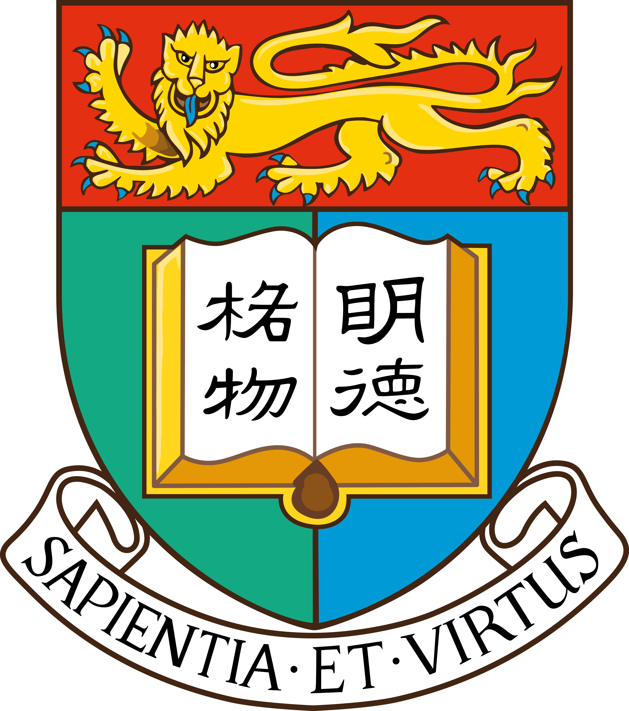

  

    <h1>Yilai Liu</h1>
    
MPhil · HKU ECE

    
<i class="fas fa-fw fa-location-dot" aria-hidden="true"></i> Hong Kong, China · <a href="{{ site.author.employer_uri }}">{{ site.author.employer }}</a>

    

      
I am <strong>Yilai Liu</strong>, currently pursuing a <strong>Master of Philosophy</strong> degree at <strong>the University of Hong Kong (HKU)</strong>. I conduct my research at <a href="https://hongyangdu.github.io/nice/"><strong>NICE Lab</strong></a> under the supervision of <strong>Prof. Hongyang Du</strong>. Before that, I received my B.Eng. degree from <strong>Beijing University of Posts and Telecommunications (BUPT)</strong>.

      
My earlier research focused on temporal representation modeling for mobile data. I now work on improving the <strong>efficiency and consistency</strong> of <strong>long-video generation and agentic video generation</strong>.

      
Feel free to contact me at <a href="mailto:2369475677@qq.com">2369475677@qq.com</a> for any potential discussion, collaboration and opportunity.

    

  

  

    
  

  <ul class="profile-intro__contacts" aria-label="Contact and academic profiles">
    <li><a href="mailto:{{ site.author.email }}"><i class="fas fa-fw fa-envelope" aria-hidden="true"></i> {{ site.author.email }}</a></li>
    <li><i class="fab fa-fw fa-weixin" aria-hidden="true"></i> WeChat: {{ site.author.wechat | escape }}</li>
    <li><a href="{{ site.author.googlescholar }}"><i class="ai ai-google-scholar ai-fw" aria-hidden="true"></i> Google Scholar</a></li>
    <li><a href="{{ site.author.orcid }}"><i class="ai ai-orcid ai-fw" aria-hidden="true"></i> ORCID</a></li>
    <li><a href="https://github.com/{{ site.author.github }}"><i class="fab fa-fw fa-github" aria-hidden="true"></i> GitHub</a></li>
  </ul>

  <h2>Education</h2>
  

    

      

        
      

      

        
2025 - Present

        
<strong>The University of Hong Kong</strong>

        
Master of Philosophy,
        Department of Electrical and Computer Engineering

      

    

    

      

        
      

      

        
2021 - 2025

        
<strong>Beijing University of Posts and Telecommunications</strong>

        
Bachelor of Engineering

      

    

  

  

    <h2>Selected Works</h2>
    <a href="/research/">View all</a>
  

  

    
    
    
    
    
      
    
    
    <h3 class="selected-work-category">{{ category[1].title }}</h3>
    
    
    

      

        
        

          
        

        
        

      
{{ post.title }}

      

        {{ post.venue }}
        {{ post.date | date: "%Y" }}
      

      
      
{{ post.authors | replace: 'Yilai Liu', '<strong><u>Yilai Liu</u></strong>' }}

      
      
{{ post.citation | strip_html }}

      
      
      
{{ post.excerpt }}

      
      

        <a href="{{ post.paperurl }}">[Paper]</a>
        <a href="{{ post.slidesurl }}">[Slides]</a>
        <a href="{{ post.bibtexurl }}">[BibTeX]</a>
      

        

      

    

    
    
  

  <h2>Competitions &amp; Awards</h2>
  

    

      ISPRS TC I Contest on Remote Sensing
       - 
      Rank 2/43
      2024
    

    

      China International College Students' Innovation Competition
       - 
      National Second Prize
      2024
    

    

      Chinese Mathematics Competitions for College Students
       - 
      National Second Prize
      2022
    

  

